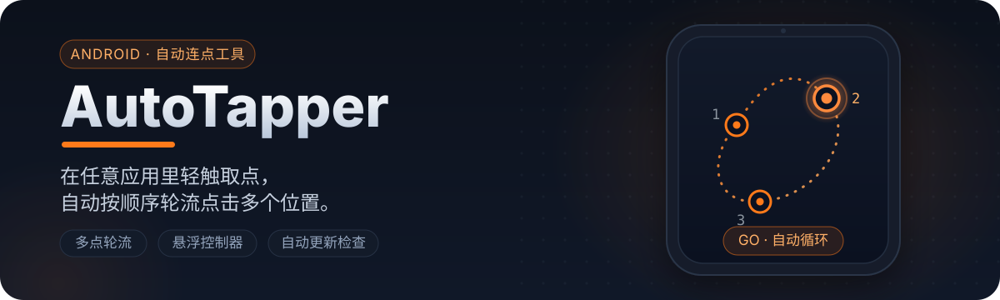
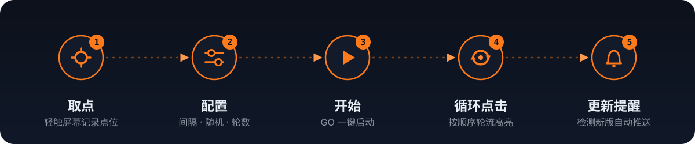

<p align="center">
  
</p>

<p align="center">
  English · <a href="README.md">中文</a>
</p>

<p align="center">
  <a href="https://github.com/JX-Lab/AutoTapper/actions/workflows/android.yml"></a>
  <a href="https://github.com/JX-Lab/AutoTapper/releases/latest"></a>
  
  <a href="./LICENSE"></a>
  <a href="https://github.com/JX-Lab/AutoTapper/pulls"></a>
</p>

## What is AutoTapper?

AutoTapper is a lightweight Android auto-tapping tool. It performs tap gestures through the system accessibility service and uses a draggable floating controller to capture points, adjust settings, start, pause, and stop from any app.

It can cycle through multiple saved points in order, which is useful for authorized repetitive testing, demonstrations, and device-operation assistance. Enabling accessibility never starts tapping by itself: the user must explicitly press play on the floating controller.

## Highlights

- **Ordered multi-point tapping:** fixed or infinite rounds through every saved point.
- **Complete floating controller:** capture points, adjust timing, start, pause, stop, and delete points without leaving the target app.
- **Integrated point capture:** plus enters point-selection mode, while count, cancel, and done controls finish the session; opening the controller never starts capture by itself.
- **Visible tap points:** translucent markers show saved positions and pulse at the active point.
- **Timing controls:** base interval plus an optional random extra delay; minimum interval is 100 ms.
- **Pause and resume:** preserve the current point, per-point tap progress, and completed rounds.
- **Saved profiles:** save, update, switch, and delete complete point-and-timing setups.
- **Per-point controls:** configure delay, consecutive tap count, and press duration for every point.
- **Point management and migration:** inspect or remove individual points and migrate legacy single-point data.
- **Large-screen and bilingual UI:** phone and `w600dp` layouts with an in-app English, Simplified Chinese, or Follow System selector.
- **Theme and language controls:** choose Light, Night, or Follow System, and switch between Simplified Chinese, English, or the system language.
- **Edge-snapping controller:** drag and release to dock to the nearest edge; the default position is the right edge.
- **Text-only tutorial:** the top-right help button explains permissions, point capture, playback, deletion, and collapse.
- **Low-distraction feedback:** normal capture and playback no longer trigger repeated Toast messages; permission, validation, and execution errors still do.
- **Update alerts:** check the latest release from this repository and ignore a selected version.

## Compatibility and downloads

| Item | Requirement |
| --- | --- |
| Minimum Android | Android 7.0 (API 24) |
| Target SDK | Android 14 (API 34) |
| Build JDK | JDK 17 |
| Latest build | [GitHub Releases](https://github.com/JX-Lab/AutoTapper/releases/latest) |

> The current release automation primarily publishes debug APKs for testing and evaluation. Treat them as preview builds until a stable release-signing process is in place.

## Permissions

| Permission | Purpose | Used when |
| --- | --- | --- |
| Display over other apps | Controller, point picker, and point markers | The floating controller is open |
| Accessibility service | Dispatch tap gestures at saved coordinates | The user starts tapping |
| Foreground service | Keep the controller available while switching apps | The controller is running |
| Internet | Query this repository's GitHub release | Automatic or manual update check |
| Notifications | Controller status and update alerts | Notifications are allowed by the system |

AutoTapper does not read screen text or upload saved points. Coordinates and settings remain in local app storage. Verify the APK source before granting accessibility access.

## Quick start

1. Download and install an APK from [Releases](https://github.com/JX-Lab/AutoTapper/releases/latest).
2. Grant overlay permission and enable the AutoTapper accessibility service; granted rows disappear automatically.
3. Configure global timing. Every numeric field explains its valid range and effect; individual points can override delay, tap count, and press duration.
4. Open the floating controller. It does not start point capture; press the plus icon only when you want to add points.
5. Use play to start; the controller collapses automatically so it does not cover the target. Reopen it to pause or resume. The square stops while running and becomes one-tap clear-all after stopping; trash removes the last point.

<p align="center">
  
</p>

## Tap sequence

With points A, B, and C saved, one round is:

```text
A → wait → B → wait → C → round complete → A → …
```

| Setting | Valid range and effect | Example |
| --- | --- | --- |
| Base interval | At least `100 ms`; lower values tap faster, while `300–800 ms` suits most screens | `400` |
| Random extra delay | `0` or more; adds a random `0..N ms`, and `0` keeps a fixed rhythm | `80` |
| Rounds | `0` runs until manually stopped; `1` runs the full sequence once | `10` |
| Per-point delay | `0` uses the global interval; a positive value overrides it for that point | `0` |
| Taps per point | `1–9999`; the sequence moves on only after these consecutive taps | `1` |
| Press duration | `20–10000 ms`; about `40 ms` is a tap and roughly `500+ ms` usually acts as a long press | `40` |

A 400 ms base interval and 80 ms random delay produce a 400–480 ms wait after each tap.

## Floating controller

- **Plus:** enter point-selection mode and add multiple points; finish or cancel from the same controller.
- **Trash:** remove the last point.
- **Play / pause:** start, pause, or resume the current setup. Starting automatically collapses the controller so it does not cover the target.
- **Square:** stop while running; after stopping, the same button becomes one-tap clear-all.
- **Settings:** edit interval, random delay, rounds, press duration, and taps per point from the overlay; values stay synchronized with the main screen.
- **Chevron / ×:** collapse to the edge handle or close the controller completely.
- **Drag:** both the controller and handle snap to the nearest screen edge when released.

## Build from source

Install JDK 17 and Android SDK 34, then use the included Gradle Wrapper:

```bash
git clone https://github.com/JX-Lab/AutoTapper.git
cd AutoTapper
./gradlew assembleDebug
```

Windows:

```powershell
.\gradlew.bat assembleDebug
```

The APK is written to `app/build/outputs/apk/debug/app-debug.apk`.

## Project structure

```text
app/src/main/
├── java/com/example/autotapper/
│   ├── AutoClickService.kt   # Accessibility tap executor
│   ├── OverlayService.kt     # Floating controller and point picker
│   ├── MainActivity.kt       # Settings and point management
│   ├── AutoTapperConfig.kt   # Local storage and migration
│   ├── ProfileListAdapter.kt # Saved-profile list
│   ├── TutorialActivity.kt   # In-app text tutorial
│   └── UpdateChecker.kt      # GitHub Release update checks
└── res/                      # Layouts, vector assets, theme, and localization
```

## Contributing

Thank you to the contributors who directly shaped AutoTapper's features and experience. Attribution follows the original pull requests and commit history:

| Contributor | Main contributions |
| --- | --- |
| [@YangZiyueZY](https://github.com/YangZiyueZY) | Contributed ordered multi-point tapping, the draggable floating controller, point management and migration, update checks, and release automation in [PR #5](https://github.com/JX-Lab/AutoTapper/pull/5). Also delivered the main-screen and overlay redesign, opacity control, large-screen layouts, and the README hero and workflow visuals. |
| [@Rose088211](https://github.com/Rose088211) | Contributed the initial English UI resources and English README in [PR #4](https://github.com/JX-Lab/AutoTapper/pull/4), establishing the foundation for the project's bilingual support. |

If your name or contribution summary needs correction, please open an Issue or PR and we will update it according to the commit history.

Bug reports, documentation improvements, translations, and focused feature pull requests are welcome. Read [CONTRIBUTING.md](./CONTRIBUTING.md) before starting.

1. Search or open an Issue describing the problem, reproduction steps, or feature boundaries.
2. Create a focused branch from the latest `main`.
3. Update both default English and Simplified Chinese resources.
4. Run `./gradlew assembleDebug` and test the primary flow on a device or emulator.
5. Open a PR explaining why, how it was validated, and include screenshots for UI work.

## Safety boundaries

- Use AutoTapper only on devices and workflows you are authorized to automate.
- Do not use it to bypass CAPTCHAs, risk controls, queues, purchase limits, or third-party platform rules.
- Test points, round count, and the stop action on a non-critical screen first.
- Report unexpected permission use or background behavior without publishing sensitive details.

## Known limitations

- Swipe and complex action sequences are not supported yet; swipe actions are being designed, while the current release remains tap-and-hold only.
- Saved coordinates do not adapt automatically to layout changes or screen rotation.
- Scheduled start is still under discussion; e-commerce server-time synchronization is not implemented.

## Changelog and license

- See [CHANGELOG.md](./CHANGELOG.md) for release history.
- AutoTapper is released under the [MIT License](./LICENSE). You may use, modify, distribute, and sublicense it provided that the copyright and permission notices are retained.
