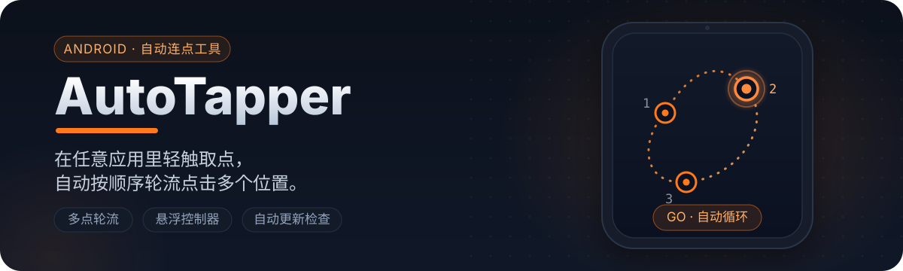

<p align="center">
  
</p>

<p align="center">
  English · <a href="README.md">中文</a>
</p>

<p align="center">
  <a href="https://github.com/JX-Lab/AutoTapper/actions/workflows/android.yml"></a>
  <a href="https://github.com/JX-Lab/AutoTapper/releases/latest"></a>
  
  <a href="https://github.com/JX-Lab/AutoTapper/pulls"></a>
</p>

## What is AutoTapper?

AutoTapper is a lightweight Android auto-tapping tool. It performs tap gestures through the system accessibility service and uses a draggable floating controller to record points, start, and stop from any app.

It can cycle through multiple saved points in order, which is useful for authorized repetitive testing, demonstrations, and device-operation assistance. Enabling accessibility never starts tapping by itself: the user must press `GO` or **Start Tapping**.

## Highlights

- **Ordered multi-point tapping:** fixed or infinite rounds through every saved point.
- **Draggable floating controller:** use `+`, `DEL`, `GO`, and `STOP` from any app.
- **Visible tap points:** translucent markers show saved positions and pulse at the active point.
- **Timing controls:** base interval plus an optional random extra delay; minimum interval is 100 ms.
- **Point management and migration:** inspect or remove individual points and migrate legacy single-point data.
- **Large-screen and bilingual UI:** phone and `w600dp` layouts with English and Simplified Chinese.
- **Update alerts:** check the latest release from this repository and ignore a selected version.

## Compatibility and downloads

| Item | Requirement |
| --- | --- |
| Minimum Android | Android 7.0 (API 24) |
| Target SDK | Android 14 (API 34) |
| Build JDK | JDK 17 |
| Latest build | [GitHub Releases](https://github.com/JX-Lab/AutoTapper/releases/latest) |

> The current release automation primarily publishes debug APKs for testing and evaluation. Treat them as preview builds until a stable release-signing process is in place.

## Permissions

| Permission | Purpose | Used when |
| --- | --- | --- |
| Display over other apps | Controller, point picker, and point markers | The floating controller is open |
| Accessibility service | Dispatch tap gestures at saved coordinates | The user starts tapping |
| Foreground service | Keep the controller available while switching apps | The controller is running |
| Internet | Query this repository's GitHub release | Automatic or manual update check |
| Notifications | Controller status and update alerts | Notifications are allowed by the system |

AutoTapper does not read screen text or upload saved points. Coordinates and settings remain in local app storage. Verify the APK source before granting accessibility access.

## Quick start

1. Download and install an APK from [Releases](https://github.com/JX-Lab/AutoTapper/releases/latest).
2. Grant overlay permission and enable the AutoTapper accessibility service.
3. Configure the base interval, random delay, and number of rounds.
4. Open the floating controller, tap each target position, and finish point selection.
5. Expand the side controller and press `GO`; press `STOP` to stop immediately.

<p align="center">
  
</p>

## Tap sequence

With points A, B, and C saved, one round is:

```text
A → wait → B → wait → C → round complete → A → …
```

| Setting | Meaning | Example |
| --- | --- | --- |
| Base interval | Minimum milliseconds between taps | `400` |
| Random extra delay | Adds a random `0..N` milliseconds | `80` |
| Rounds | One tap at every point; `0` means infinite | `10` |

A 400 ms base interval and 80 ms random delay produce a 400–480 ms wait after each tap.

## Floating controller

- `+`: enter point-selection mode and add multiple points.
- `DEL`: remove the last point.
- `GO`: start at the first point.
- `STOP`: cancel all future taps immediately.
- Drag the handle to move the controller.
- Collapse the controller to hide point markers.

## Build from source

Install JDK 17 and Android SDK 34, then use the included Gradle Wrapper:

```bash
git clone https://github.com/JX-Lab/AutoTapper.git
cd AutoTapper
./gradlew assembleDebug
```

Windows:

```powershell
.\gradlew.bat assembleDebug
```

The APK is written to `app/build/outputs/apk/debug/app-debug.apk`.

## Project structure

```text
app/src/main/
├── java/com/example/autotapper/
│   ├── AutoClickService.kt   # Accessibility tap executor
│   ├── OverlayService.kt     # Floating controller and point picker
│   ├── MainActivity.kt       # Settings and point management
│   ├── AutoTapperConfig.kt   # Local storage and migration
│   └── UpdateChecker.kt      # GitHub Release update checks
└── res/                      # Layouts, vector assets, theme, and localization
```

## Contributing

Bug reports, documentation improvements, translations, and focused feature pull requests are welcome. Read [CONTRIBUTING.md](./CONTRIBUTING.md) before starting.

1. Search or open an Issue describing the problem, reproduction steps, or feature boundaries.
2. Create a focused branch from the latest `main`.
3. Update both default English and Simplified Chinese resources.
4. Run `./gradlew assembleDebug` and test the primary flow on a device or emulator.
5. Open a PR explaining why, how it was validated, and include screenshots for UI work.

Current proposals are tracked in [Issues](https://github.com/JX-Lab/AutoTapper/issues), including [#1 scheduled tapping](https://github.com/JX-Lab/AutoTapper/issues/1).

See the [scheduled-start design note](./docs/issue-1-scheduled-start.md) for the proposed scope, timing model, and test plan for Issue #1.

## Safety boundaries

- Use AutoTapper only on devices and workflows you are authorized to automate.
- Do not use it to bypass CAPTCHAs, risk controls, queues, purchase limits, or third-party platform rules.
- Test points, round count, and the stop action on a non-critical screen first.
- Report unexpected permission use or background behavior without publishing sensitive details.

## Known limitations

- Swipe, long-press, and complex action sequences are not supported.
- Saved coordinates do not adapt automatically to layout changes or screen rotation.
- Scheduled start is still under discussion; e-commerce server-time synchronization is not implemented.

## Changelog and license

- See [CHANGELOG.md](./CHANGELOG.md) for release history.
- This repository does not currently include an explicit open-source license. All rights are reserved by default until a license is added; contact the maintainer before reusing or redistributing the code.
